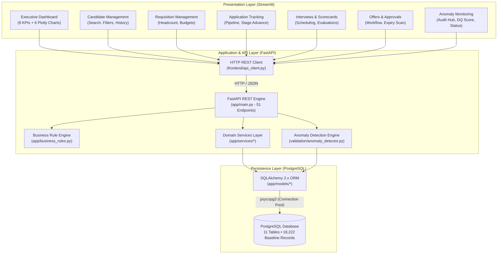
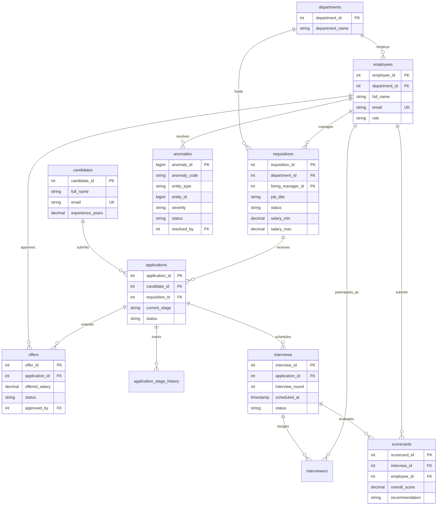

# RecruitFlow – Enterprise Recruitment Management & Analytics System

[](https://www.python.org/)
[](https://fastapi.tiangolo.com/)
[](https://streamlit.io/)
[](https://www.postgresql.org/)
[](https://www.sqlalchemy.org/)
[](https://plotly.com/)
[](https://pytest.org/)

**RecruitFlow** is a production-grade, enterprise recruitment management platform and compliance analytics system. Built on **FastAPI**, **PostgreSQL**, and **Streamlit**, RecruitFlow manages the full candidate lifecycle—from requisition headcount and talent sourcing through multi-round panel interviews, structured scorecard evaluations, executive offer approvals, and automated hiring compliance audit.

The system features an autonomous **Data Quality and Anomaly Detection Engine** that continuously scans recruitment records across 10 deterministic rule categories (**A01–A10**), identifying discrepancies, schedule overlaps, compensation outliers, and invalid stage transitions with an entity-level, non-double-counting data quality metric.

---

## 1. System Architecture

RecruitFlow follows a strict decoupled 3-tier architecture:



### Architectural Guarantees:
1. **Zero Direct DB Access from Frontend**: The Streamlit frontend interacts exclusively with the FastAPI backend through HTTP REST APIs via `frontend/api_client.py`.
2. **Deterministic Business Rule Enforcement**: Domain rules (candidate experience verification, authorized offer approver roles, duplicate application blocks, scorecard ranges) are strictly enforced in the service layer before persistence.
3. **Idempotent Anomaly Deduplication**: Re-running the anomaly detection engine across the active database records updates existing unresolved records without generating duplicate entries.

---

## 2. Technology Stack

| Layer | Component | Version | Purpose |
| :--- | :--- | :--- | :--- |
| **Frontend** | Streamlit | 1.66.1 | Modern SaaS reactive user interface |
| **Visualizations** | Plotly Express & Graph Objects | 7.1.0 | Interactive pipeline funnels, trends, and donuts |
| **Data Manipulation** | Pandas & NumPy | 3.1.0 / 2.5.4 | DataFrame structuring, statistical IQR bounds |
| **Backend API** | FastAPI & Starlette | 0.162.0 / 1.10.0 | High-performance async REST API with OpenAPI `/docs` |
| **Validation** | Pydantic v2 | 2.14.2 | Strict request/response payload typing and validation |
| **ORM & Database** | SQLAlchemy & Psycopg 3 | 2.1.6 / 3.3.6 | Relational mapping, connection pooling, typed DDL |
| **Database** | PostgreSQL | 16+ | Enterprise relational storage with check constraints |
| **Testing** | Pytest | 9.2.0 | Automated unit, integration, and end-to-end test suites |

---

## 3. Project Structure

```text
RecruitFlow/
├── app/                               # FastAPI Application Core
│   ├── api/
│   │   ├── routes/                    # Modular REST API Routers (51 Endpoints)
│   │   │   ├── analytics.py           # Real-time Dashboard Aggregations
│   │   │   ├── anomalies.py           # Anomaly Engine & Data Quality Endpoints
│   │   │   ├── applications.py        # Application Pipeline & Stage History
│   │   │   ├── candidates.py          # Candidate Profiles & Search
│   │   │   ├── departments.py         # Department Allocations
│   │   │   ├── employees.py           # Employee Directory & Roles
│   │   │   ├── interviews.py          # Interview Rounds & Panelist Assignments
│   │   │   ├── offers.py              # Offer Lifecycle & Multi-Stage Approvals
│   │   │   ├── requisitions.py        # Headcount Budgets & Status Transitions
│   │   │   └── scorecards.py          # Numerical Evaluations & Recommendations
│   │   └── routes.py                  # Central Router Registry
│   ├── models/                        # SQLAlchemy 2.x Declarative Models
│   │   ├── anomaly.py                 # Anomaly Audit Records
│   │   ├── application.py             # Applications
│   │   ├── application_stage_history.py# Immutable Stage Transition Audit
│   │   ├── base.py                    # Declarative Base
│   │   ├── candidate.py               # Candidates
│   │   ├── department.py              # Departments
│   │   ├── employee.py                # Employees
│   │   ├── interview.py               # Interviews
│   │   ├── interviewer.py             # Panelist Assignments (Association)
│   │   ├── offer.py                   # Offers
│   │   ├── requisition.py             # Job Requisitions
│   │   └── scorecard.py               # Interviewer Scorecards
│   ├── schemas/                       # Pydantic Request & Response Schemas
│   ├── services/                      # Domain Business Logic & Workflow Services
│   ├── business_rules.py              # Central Domain Exception & Rule Engine
│   ├── database.py                    # PostgreSQL Engine, SessionLocal & get_db Dependency
│   └── main.py                        # FastAPI Application Entry & CORS Middleware
├── frontend/                          # Streamlit Enterprise Frontend
│   ├── app.py                         # Streamlit Entrypoint & SaaS Design System
│   ├── api_client.py                  # Reusable HTTP REST Client
│   ├── components/
│   │   ├── charts.py                  # Plotly Interactive Visualizations
│   │   ├── metrics.py                 # Styled KPI Card Components
│   │   ├── sidebar.py                 # Sidebar Navigation & Backend Health Status
│   │   └── tables.py                  # Table Formatters & Status Pill Badges
│   └── pages/
│       ├── dashboard.py               # Executive Analytics Overview
│       ├── candidates.py              # Candidate Management & Search
│       ├── requisitions.py            # Requisition Management & Budgets
│       ├── applications.py            # Application Tracking & History
│       ├── interviews.py              # Interview Schedule & Scorecards
│       ├── offers.py                  # Offer Approval Workflow Hub
│       └── anomalies.py               # Anomaly Hub & Remediation Workflow
├── generator/                         # Synthetic Data Generation Module
│   └── synthetic_data.py              # Weighted Realistic Enterprise Data Generator
├── validation/                        # Data Quality & Anomaly Detection Engine
│   ├── anomaly_detector.py            # Audit Orchestrator
│   ├── anomaly_rules.py               # Pure Detection Functions (A01 - A10)
│   ├── data_quality.py                # Non-Double-Counting DQ Score Formula
│   ├── validation_service.py          # Idempotent Persistence & Investigation Workflows
│   └── run_audit.py                   # CLI Anomaly Audit Tool
├── tests/                             # Comprehensive Automated Test Suite (222 Tests)
│   ├── conftest.py                    # Pytest Fixtures & In-Memory SQLite StaticPool Test DB
│   ├── test_anomaly_detector.py       # Backward-Compatibility Anomaly Unit Tests
│   ├── test_anomaly_engine.py         # Dedicated A01-A10 Anomaly & Persistence Tests
│   ├── test_api.py                    # FastAPI 51-Endpoint Integration Tests
│   ├── test_database.py               # Schema, Foreign Key & Model Relationship Tests
│   ├── test_e2e_workflows.py          # End-to-End User Journeys (Workflows 1-4)
│   └── test_frontend.py               # Streamlit API Client & Plotly Chart Unit Tests
├── .env.example                       # Environment Variable Template
├── .gitignore                         # Secure Git Exclusion Rules
├── pytest.ini                         # Pytest Configuration
└── requirements.txt                   # Frozen Production Dependencies
```

---

## 4. Database Schema Documentation

The PostgreSQL database `recruitment_db` consists of 11 normalized tables with referential integrity constraints and composite lookup indexes:



### Table Summary & Record Counts (Baseline Dataset)
- `departments`: 5 departments (Engineering, Sales, Product, Marketing, HR)
- `employees`: 50 employees (Managers, Directors, HR, Panelists)
- `job_requisitions`: 202 requisitions (106 Open, 96 Closed/On Hold)
- `candidates`: 5,004 registered candidates
- `applications`: 8,005 submitted applications
- `application_stage_history`: 8,005 initial + progression stage logs
- `interviews`: 2,003 scheduled and completed interview rounds
- `interviewers`: 2,003 panelist assignments
- `scorecards`: 2,004 evaluated scorecards
- `offers`: 1,004 compensation packages
- `anomalies`: 8,600 detected compliance and workflow anomalies

---

## 5. Anomaly Detection Engine (A01 – A10)

The engine in [`validation/`](file:///c:/Users/Harshitha/Recruitflow/validation/) implements 10 deterministic compliance rules:

| Code | Category | Severity | Description |
| :--- | :--- | :--- | :--- |
| **A01** | **Candidate Experience** | `Medium` / `Low` | Detects experience $< \text{req}.\text{min}$ (`Medium`) or $> \text{req}.\text{max}$ (`Low` / `Medium`). |
| **A02** | **Duplicate Applications** | `High` / `Medium` | Flag repeated candidate applications for the same requisition or $\ge 5$ mass applications. |
| **A03** | **Interview Assignment** | `Critical` / `High` | Interviews without panelists or assigned employees missing from the directory. |
| **A04** | **Interview Scheduling** | `Critical` / `High` | Completion before scheduled time (`Critical`) or panelist overlapping schedules $< 45$ min (`High`). |
| **A05** | **Scorecards** | `Critical` / `Medium` | Scores submitted by non-assigned panelists, out-of-bound scores (not 0–10), or score/recommendation discrepancies. |
| **A06** | **Offer Approvals** | `Critical` / `High` | Released offers without approver (`Critical`) or approved by unauthorized roles (`High`). |
| **A07** | **Offer Dates** | `Critical` / `High` | Expiry or joining date preceding offer date (`Critical`). |
| **A08** | **Salary Anomalies** | `Critical` / `High` | Offered salary below minimum, above maximum, or extreme outlier $> 3\times\text{max}$ / statistical IQR bounds (`Critical`). |
| **A09** | **Workflow Transitions** | `Critical` / `High` | Invalid stage jumps (`applied` to `offer`), inconsistent stage history, or rejected applications receiving interviews. |
| **A10** | **Recruitment Process** | `High` / `Medium` | Closed requisitions retaining active applications or interviews scheduled for rejected applications. |

### Data Quality Percentage Formula (Non-Double-Counting)
$$\text{Data Quality \%} = \max\left(0.0, \frac{\text{Total Records Inspected} - \text{Unique Active Anomalous Entities}}{\text{Total Records Inspected}} \times 100\right)$$

- **Total Records Inspected**: $18,222$
- **Total Raw Anomalies**: $8,600$
- **Unique Anomalous Entities**: $7,162$
- **Clean Compliant Records**: $11,060$
- **Baseline Data Quality Score**:
  $$\frac{18,222 - 7,162}{18,222} \times 100 = \mathbf{60.70\%}$$

When an anomaly is moved to `Resolved` or `False Positive`, the entity returns to the clean pool, restoring the score automatically.

---

## 6. End-to-End Recruitment Workflows

RecruitFlow supports 4 end-to-end recruitment journeys, fully automated and covered by [`tests/test_e2e_workflows.py`](file:///c:/Users/Harshitha/Recruitflow/tests/test_e2e_workflows.py):

### Workflow 1 – Candidate Recruitment
1. Register candidate (`POST /candidates/`).
2. Create or select open requisition (`POST /requisitions/`).
3. Submit candidate application (`POST /applications/`).
4. Advance through recruitment stages: `applied` $\to$ `screening` $\to$ `interview` $\to$ `assessment` $\to$ `offer` (`PATCH /applications/{id}/stage`).
5. Audit complete immutable timeline (`GET /applications/{id}/history`).

### Workflow 2 – Interview Process
1. Schedule interview round (`POST /interviews/`).
2. Assign interview panelist (`POST /interviews/{id}/assign-interviewer`).
3. Complete round (`PATCH /interviews/{id}/status`).
4. Submit multi-metric scorecard evaluation (`POST /scorecards/`).
5. Review aggregate interview summary and recommendation breakdown (`GET /scorecards/interview/{id}/summary`).

### Workflow 3 – Offer Process
1. Generate draft compensation package (`POST /offers/`).
2. Submit for management review (`POST /offers/{id}/submit-for-approval`).
3. Executive review & approval by authorized role (`POST /offers/{id}/approve`).
4. Formally release offer to candidate (`POST /offers/{id}/release`).
5. Record candidate acceptance (`POST /offers/{id}/accept`), automatically transitioning application stage to `hired`.

### Workflow 4 – Anomaly Detection & Remediation
1. Continuous or manual scan trigger (`POST /anomalies/detect`).
2. Query discrepancies filtered by category/severity (`GET /anomalies/category/{category}`).
3. Inspect detailed diagnosis and recommended remediation action (`GET /anomalies/{id}`).
4. Update investigation status to `Investigating` and `Resolved` (`PATCH /anomalies/{id}/status`).
5. Real-time data quality score and metric refresh on the executive dashboard (`GET /anomalies/summary`).

---

## 7. Installation & Quickstart Guide

### Prerequisites
- Python 3.11+
- PostgreSQL 14+ running on `localhost:5432`

### 1. Environment Setup

#### Windows PowerShell:
```powershell
# 1. Clone or navigate to the repository
cd C:\Users\Harshitha\Recruitflow

# 2. Create virtual environment
python -m venv .venv

# 3. Activate virtual environment
.venv\Scripts\Activate.ps1

# 4. Install production dependencies
pip install -r requirements.txt
pip install plotly
```

#### Git Bash / Linux / macOS:
```bash
# 1. Create and activate virtual environment
python3 -m venv .venv
source .venv/bin/activate

# 2. Install dependencies
pip install -r requirements.txt
pip install plotly
```

### 2. Environment Configuration
Copy `.env.example` to `.env` and configure your PostgreSQL database credentials:
```ini
DB_HOST=localhost
DB_PORT=5432
DB_NAME=recruitment_db
DB_USER=postgres
DB_PASSWORD=your_password_here

BACKEND_URL=http://localhost:8000
API_TIMEOUT_SECONDS=30
```

### 3. Database Initialization & Data Seeding
Run the database creation and synthetic data generation scripts:
```powershell
# Create all PostgreSQL tables
python create_tables.py

# Generate synthetic baseline dataset (5,000+ candidates, 8,000+ applications, controlled anomalies)
python seed_data.py
python seed_applications.py
python seed_interviews.py
python seed_scorecards.py
python seed_offers.py

# Run initial anomaly detection audit
python -m validation.run_audit
```

---

## 8. Running the Application

### 1. Start the FastAPI Backend
```powershell
.venv\Scripts\activate
uvicorn app.main:app --port 8000 --reload
```
### 1. Automated Full-Stack Launch (Windows PowerShell)
To launch both the FastAPI backend and Streamlit frontend in concurrent terminal sessions:
```powershell
.\start_all.ps1
```

### 2. Manual Service Launch

#### Step A: Start the FastAPI Backend
```powershell
.venv\Scripts\activate
uvicorn app.main:app --port 8000 --reload
```
- **API Base URL**: [http://localhost:8000](http://localhost:8000)
- **Interactive Swagger Documentation**: [http://localhost:8000/docs](http://localhost:8000/docs)
- **ReDoc Documentation**: [http://localhost:8000/redoc](http://localhost:8000/redoc)

#### Step B: Start the Streamlit Frontend
In a new terminal:
```powershell
.venv\Scripts\activate
streamlit run frontend/app.py --server.port 8501
```
- **Streamlit Web Application**: [http://localhost:8501](http://localhost:8501)

### 3. Containerized Deployment (Docker & Docker Compose)
To run the complete full-stack environment (PostgreSQL 16, FastAPI backend, and Streamlit frontend) with persistent volume storage:
```bash
docker compose up --build
```
- **Backend API**: `http://localhost:8000`
- **Frontend Dashboard**: `http://localhost:8501`

### 4. Cloud Deployment (Render.com)
The project includes a production blueprint `render.yaml` defining:
1. `recruitflow-db`: Managed PostgreSQL database.
2. `recruitflow-backend`: FastAPI Web Service with automatic healthchecks (`/health`).
3. `recruitflow-frontend`: Streamlit Web Service wired via `BACKEND_API_URL`.

To deploy:
1. Connect the RecruitFlow repository to Render.
2. Click **New +** > **Blueprint**.
3. Select `render.yaml` to deploy all three services automatically.

---

## 9. Comprehensive Testing

RecruitFlow includes an automated Pytest test suite covering all modules:

```powershell
.venv\Scripts\activate
pytest --tb=short
```

### Actual Test Execution Output:
```text
============================= test session starts =============================
platform win32 -- Python 3.14.4, pytest-9.2.0, pluggy-1.7.0
rootdir: C:\Users\Harshitha\Recruitflow
testpaths: ., tests
collected 222 items

test_business_rules.py . . . . . . .                                    [  3%]
tests/test_anomaly_detector.py . . .                                    [  4%]
tests/test_anomaly_engine.py . . . . . . . . . . . . . . . . . . . .    [ 26%]
tests/test_api.py . . . . . . . . . . . . . . . . . . . . . . . . .     [ 67%]
tests/test_database.py . . . . . . . . . . . . . . . . . . . . . . .     [ 90%]
tests/test_e2e_workflows.py . . . .                                     [ 91%]
tests/test_frontend.py . . . . . . . . . . . . . . . . . .              [100%]

============================ 222 passed in 9.79s =============================
```

### Test Suite Structure:
- **`test_business_rules.py`** (7 tests): Validates candidate qualification checks, offer approver role checks, and stage transition violations.
- **`tests/test_anomaly_detector.py`** (3 tests): Verifies backward compatibility of legacy anomaly detector interfaces.
- **`tests/test_anomaly_engine.py`** (49 tests): Unit and integration tests for rules A01 to A10, boundary values, IQR salary outliers, and idempotent persistence.
- **`tests/test_api.py`** (91 tests): Comprehensive HTTP status codes and CRUD operations across all 10 domain routers.
- **`tests/test_database.py`** (50 tests): Schema constraints, composite indexes, foreign keys, and model relationship integrity.
- **`tests/test_e2e_workflows.py`** (4 tests): End-to-end recruitment lifecycle user journeys (Workflows 1–4).
- **`tests/test_frontend.py`** (18 tests): Streamlit REST API client resilience, Plotly chart generation, and data formatters.

---

## 10. Security & Quality Safeguards

- **Credential Isolation**: Credentials are exclusively read from `.env` files and environment variables; `.env` is strictly ignored by version control.
- **Sanitized Error Envelopes**: Global FastAPI exception handlers intercept unhandled errors and return HTTP 500 without leaking database credentials or system tracebacks.
- **Injection Protection**: All database queries utilize parameterized SQLAlchemy ORM statements.
- **CORS Configuration**: Explicitly enables origins `http://localhost:8501` and `http://127.0.0.1:8501`.
- **Fast In-Memory Test Isolation**: Tests run in an isolated in-memory SQLite database utilizing `StaticPool` and compiler auto-increment adapters, ensuring test runs never modify development or production data.

---

## 11. Known Limitations & Future Improvements

### Known Limitations:
1. **Synchronous Email Delivery**: Candidate notifications currently log to audit records rather than transmitting live emails via SMTP / SendGrid.
2. **Local Single-Instance Storage**: Resumes and documents are tracked as metadata rather than persisted in cloud object storage (AWS S3 or Google Cloud Storage).

### Suggested Future Improvements:
1. **OAuth2 / JWT Authentication**: Integrate SSO with Google Workspace and Microsoft Azure AD with role-based JWT bearer authentication.
2. **Asynchronous Background Workers**: Offload anomaly detection scans to Celery or Redis Queue workers for distributed execution.
3. **LLM Candidate Sourcing**: Add Gemini-powered resume parsing and semantic job-to-candidate qualification matching.

